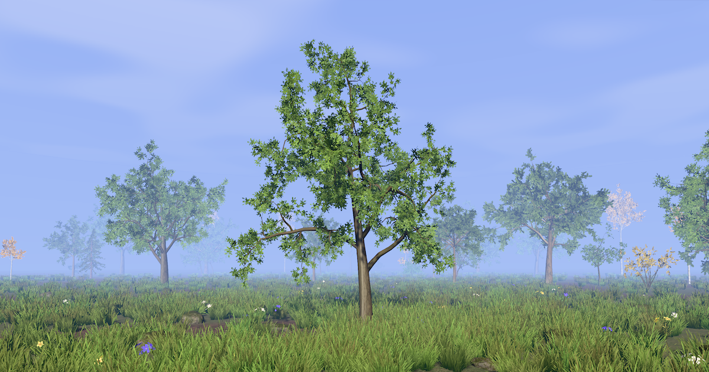
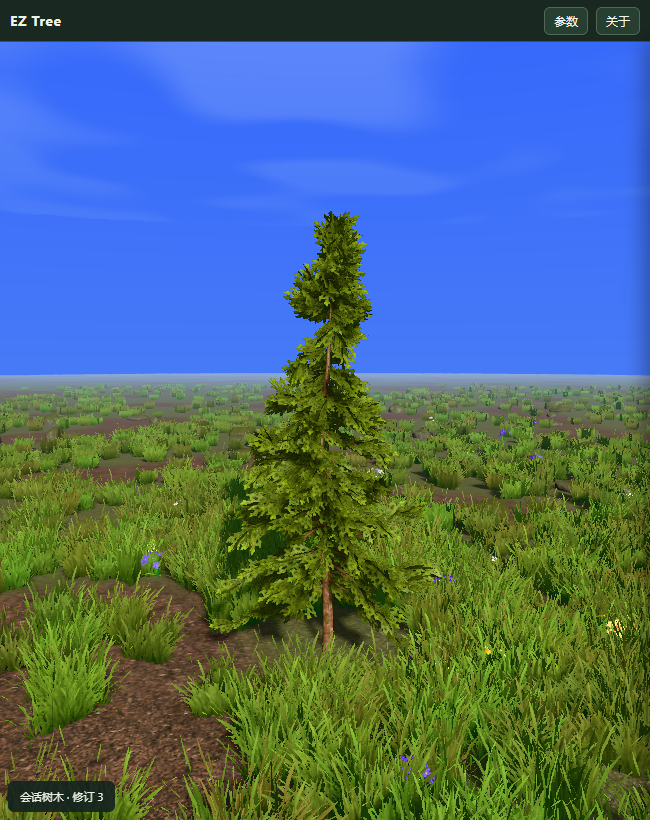

<p align="center">
  
</p>

# EZ-Tree

English · [简体中文](README.md)

A procedural 3D tree editor for DeepSeek Harness (DSH) and Seal Harness. Start from a preset, edit the tree yourself or ask an agent to refine it, and export the result as GLB, transparent PNG, or reproducible TreeOptions JSON.

## Quick start

1. Download `dsh-ez-tree-*.tgz` from [GitHub Releases](https://github.com/asun-labs/dsh-ez-tree/releases). Install and enable the package in the host's plugin manager.
2. Run `/ez-tree` in a session, or ask the agent to generate a tree with EZ-Tree. The editor opens in the current session's right-side browser.
3. Orbit or zoom the scene and adjust branches, foliage, bark, and camera settings. Exports are saved under `models/ez-tree` in the session's working directory.

<p align="center">
  
</p>

## Work in a shared session

The editor and agent tools share the same parameters, seed, and revision. Identical parameters and seeds reproduce the same tree. The plugin includes the editor, textures, and Draco decoder, so the session workflow needs only the installed bundle. Collapse the settings pane when working in a narrow sidebar.

The built-in skill can open the editor, read the current project, generate an updated tree, and export a committed revision. A standalone editor and [external MCP integration](docs/mcp.md) are also available for existing workflows.

## Develop

Use Node.js `^22.19.0 || >=24.0.0`.

```sh
npm ci
npm run check
npm run build
npm run pack:release
```

See the [upgrade guide](docs/upgrade.md) for older package names and the [validation records](docs/validation.md) for tested environments.

## Credits

Based on [EZ-Tree](https://github.com/dgreenheck/ez-tree) by Daniel Greenheck. See [NOTICE](NOTICE) and the [vendor provenance](vendor/ez-tree/provenance.json) for upstream code, textures, and license details.
