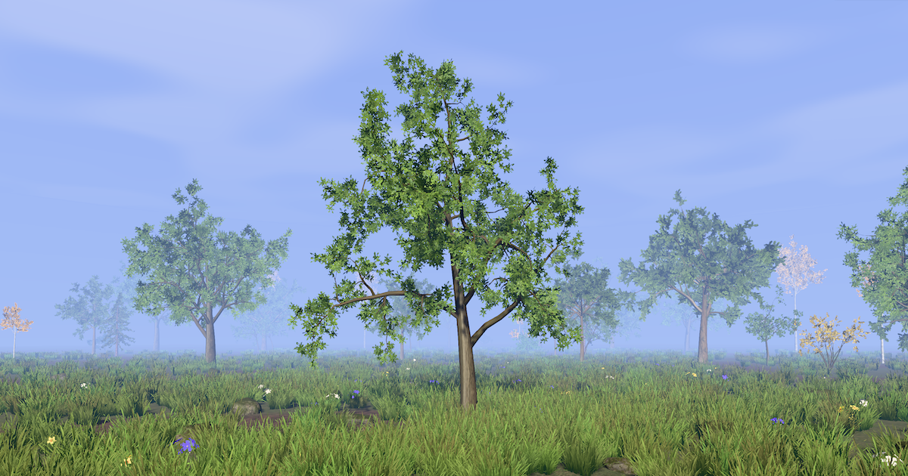
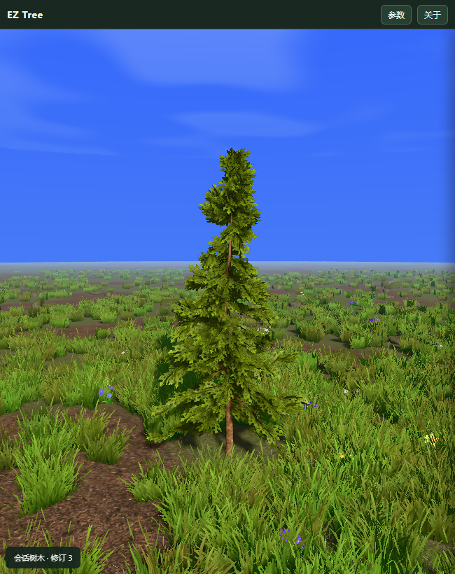
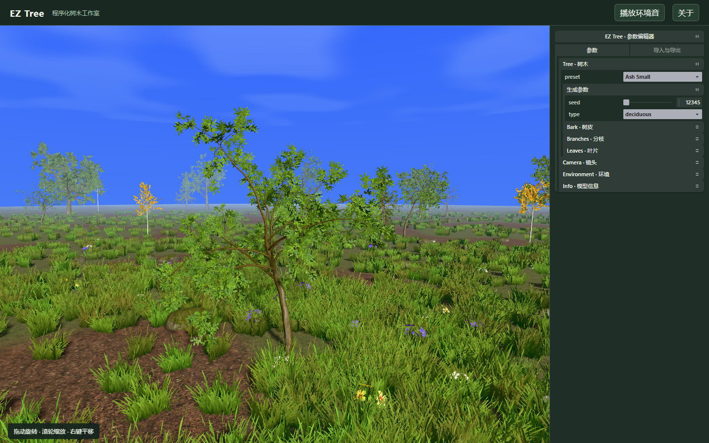

<p align="center">
  
</p>

<h1 align="center">EZ-Tree</h1>

<p align="center">
  <strong>在当前会话里，让一棵树长出来。</strong><br>
  真实三维编辑器 · 会话共享项目 · GLB / PNG / JSON 导出
</p>

<p align="center">
  <a href="https://github.com/asun-labs/dsh-ez-tree/releases">下载插件</a> ·
  <a href="#三步开始">三步开始</a> ·
  <a href="#会话里的编辑器">查看界面</a> ·
  <a href="docs/contracts.md">工程文档</a>
</p>

<p align="center">
  
  
  
</p>

---

## 会话里的编辑器

安装并启用插件后，使用内置 `ez-tree` 技能即可在 **DSH / Seal 当前会话的右侧浏览器**打开三维树木编辑器。页面由插件在本机提供，编辑器、纹理和 Draco 解码器随包交付；新会话流程无需另装桌面程序或配置 MCP。

<p align="center">
  
  <br><sub>实际会话编辑器页面 · 右侧浏览器尺寸 · 可展开参数面板</sub>
</p>

| 选一棵树 | 与智能体一起调整 | 导出可用资产 |
| :--- | :--- | :--- |
| 15 种预设，实时 WebGL 场景。 | 手动调整枝叶、树皮、环境和镜头；智能体读取并修改同一个会话项目。 | 带纹理 GLB、透明 PNG、可复现的 TreeOptions JSON。 |

右侧浏览器较窄时，参数面板可收起，三维视口保持可见。相同参数和 seed 可以复现树形。

## 三步开始

1. 从 [GitHub Releases](https://github.com/asun-labs/dsh-ez-tree/releases) 下载当前版本 `dsh-ez-tree-*.tgz`，在宿主的插件管理中安装并启用。
2. 在一个会话中调用 `/ez-tree`，或告诉智能体“使用 EZ-Tree 生成一棵松树”。技能会打开右侧浏览器，并等待真实模型渲染完成。
3. 在编辑器里旋转、缩放、调整参数，或继续让智能体修改。导出 GLB、透明 PNG 或 JSON；文件写入当前会话工作目录的 `models/ez-tree`，不覆盖已有文件。

宿主的登录、模型配置和工具权限仍由宿主管理。项目按账号和会话隔离；切换会话不会把后台任务的面板打开到另一会话。关闭面板后可再次调用技能恢复项目。工作目录变化后需重新打开编辑器，避免向旧目录写文件。

## 同一个项目，同一次修订

手动操作和原生会话工具共享树木参数、seed 与修订号。智能体修改时，实际模型渲染并核对参数后才提交修订；冲突或失败会保留已提交的项目。

| 原生工具 | 用途 |
| :--- | :--- |
| `ez_tree_open_editor` | 打开或恢复当前会话编辑器，并等待真实渲染 |
| `ez_tree_editor_get` | 读取当前已提交的项目和参数 |
| `ez_tree_editor_generate` | 合并参数，在同一面板渲染并确认修订 |
| `ez_tree_editor_export` | 导出当前项目，返回路径、修订号和 SHA-256 |

内置技能由宿主原生技能 Provider 发现。旧版由本插件原样创建的托管技能副本，仅在内容摘要完全匹配时停用并保留；用户自定义内容不会被覆盖。

## 独立桌面与旧版兼容

独立桌面编辑器和外部 MCP 仍作为兼容方式保留，适合已有工作流。它们有各自的树木状态，不会冒充当前会话可见面板。详见 [外部 MCP 说明](docs/mcp.md) 和 [运行时兼容](docs/runtime-upgrade.md)。

<p align="center">
  
  <br><sub>独立编辑器界面 · Windows x64；新会话流程不需要安装它</sub>
</p>

正式包名为 **`dsh-ez-tree`**。旧 `@asun-labs/dsh-ez-tree` 安装请使用随包迁移工具，见 [升级说明](docs/upgrade.md)。应用 ID、已有 MCP 工具名和技能名、账号数据目录保持不变，原项目与导出不会删除。

## 开发与验证

需要 Node.js `^22.19.0 || >=24.0.0` 和 npm；真实宿主测试还需满足所选 DSH 版本的 Node 要求。

```sh
npm ci
npm run check
npm run build
npm run pack:release
```

图形启动必须显式执行。测试使用独立 Home 和隐藏窗口，不占用用户焦点。插件包包含预编译 Host、客户端和完整编辑器资源，安装时不编译。真实宿主验收与已知平台范围见 [验证记录](docs/validation.md)，工程约束见 [工程契约](docs/contracts.md)。旧版独立程序的构建入口继续保留。

## 来源与许可

基于 Daniel Greenheck 的 [EZ-Tree](https://github.com/dgreenheck/ez-tree)，固定 [ASunYC/ez-tree 提交](https://github.com/ASunYC/ez-tree/tree/135ac2bf85875eacf5637d18062e690cf16a1837)。86 个上游文件保留原字节和逐项哈希；MIT、Draco Apache 2.0 及实际依赖许可随包交付。见 `NOTICE`、`licenses/` 和 `vendor/ez-tree/provenance.json`。

npm 是否可安装以实际发布状态为准；GitHub Release 不代表已经发布到 npm。
